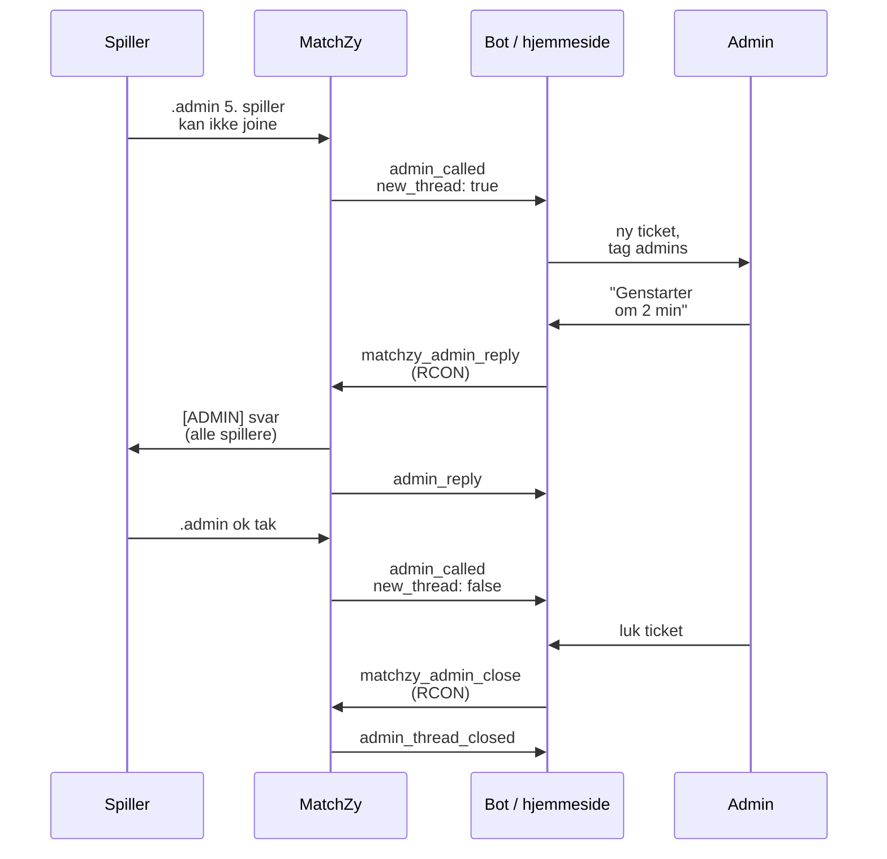

# Admin-tickets (hjemmeside / Discord-bot)

Spillere kan skrive til admins inde fra spillet, og en hjemmeside eller Discord-bot kan svare dem tilbage på serveren. MatchZy sender hver besked som et event til jeres endpoint, og jeres system svarer over RCON.

- `.admin <besked>` skriver i **kampens ticket**. Der er én åben ticket pr. kamp, alle spilleres beskeder lander i den, og alle spillere i kampen ser beskederne og admins' svar. Så ser begge hold, hvad der er aftalt ("vi restorer runde 14").
- `.report <besked>` åbner en **privat ticket**: kun den, der reporter, og admins ser den, og selve linjen vises ikke i chatten. Den er til at reporte det andet hold.

Admins på serveren ser også beskederne i chatten. Funktionen virker altså i spillet, selv uden hjemmeside eller bot.

## Slå det til

Funktionen er slået fra som standard, og mens den er fra, gør `.admin` og `.report` ingenting (et andet plugin kan eje de kommandoer). Slå den til og send events til jeres endpoint, i `config.cfg` eller en privat cfg:

```text
matchzy_admin_call_enabled true
matchzy_remote_log_url "https://example.com/matchzy/events"
matchzy_remote_log_header_key "Authorization"
matchzy_remote_log_header_value "Bearer <hemmelighed>"
```

| Indstilling | Standard | |
|---|---|---|
| `matchzy_admin_call_enabled` | `false` | Slår `.admin`, `.calladmin` og `.report` til. |
| `matchzy_admin_call_cooldown` | `5` | Sekunder mellem to beskeder fra samme spiller (spamfilter). |
| `matchzy_admin_ticket_timeout` | `30` | Minutter uden beskeder, før en ticket regnes som lukket. `0` = ingen timeout. |

En loadet kamp kan have sin egen `remote_log_url` i match configen. Ticket-events sendes så til begge URL'er, serverens og kampens.

## Sådan hænger det sammen



**`thread_id` er ticketen.** Gem den sammen med jeres eget ticket-id (Discord-kanalens id, en række i databasen). Alle beskeder, svar og luk-eventet for én ticket har samme `thread_id`.

## Events jeres endpoint modtager

Hvert event er en HTTP `POST` med en JSON-body. Tjek den header, I har sat (`Authorization: Bearer <hemmelighed>`), før I stoler på den.

### `admin_called`: en spiller har skrevet

```json
{
  "event": "admin_called",
  "matchid": 1234,
  "map_number": 0,
  "map_name": "de_mirage",
  "plugin_version": "1.0.24",
  "thread_id": "8f2c0c1e5b1a4a0e9d7c2b6a1f3e4d5c",
  "kind": "admin",
  "server": { "hostname": "Liga #3", "address": "0.0.0.0:27015" },
  "call_id": "c41d9a7e2f6b4e1a8b3c5d7e9f0a1b2c",
  "new_thread": true,
  "player": { "steamid64": "76561198000000000", "name": "Mio", "team": "team1", "side": "ct" },
  "message": "vores 5. spiller kan ikke joine",
  "called_at": "2026-11-09T18:02:11Z"
}
```

| Felt | |
|---|---|
| `new_thread` | `true` ved ticketens første besked: opret ticketen. `false`: tilføj beskeden til ticketen med dette `thread_id`. |
| `kind` | `admin` (kampens ticket, alle spillere i kampen ser den) eller `report` (privat). Fremhæv reports. |
| `call_id` | Unikt pr. besked. Hvis en levering bliver sendt igen, så gem den kun én gang. |
| `player.team` | `team1` / `team2` / `spectator`, `null` uden en loadet kamp. `side` er `ct` / `t` / `null`. |
| `matchid` | `null` uden en loadet kamp (scrim eller pug). Brug den til at linke til jeres kampside. |
| `server.address` | `ip:port`, som serveren binder til. IP'en er som regel `0.0.0.0`; porten skelner servere på samme maskine. |
| `message` | Højst 200 tegn, kan være tom (et `.admin` uden tekst). Behandl den som tekst, I ikke kan stole på. |

### `admin_reply`: en admin har svaret

Sendes efter `matchzy_admin_reply`, så svaret også kommer med i jeres historik (og andre admins ser det). Den har `from`, `message` og `sent_at` plus de fælles felter (`thread_id`, `kind`, `server`, `matchid`, ...).

### `admin_thread_closed`: ticketen er slut

`reason` er en af:

- `admin`: lukket med `matchzy_admin_close`.
- `match_end`: kampen sluttede (series end, stop eller cancel).
- `timeout`: ingen beskeder i `matchzy_admin_ticket_timeout` minutter. Det sendes, når næste besked kommer, lige før den beskeds `admin_called` med `new_thread: true`.

Den har også `closed_at` og de fælles felter.

## Svar fra jeres system (RCON)

| Kommando | |
|---|---|
| `matchzy_admin_reply <thread_id> <besked>` | Svarer på en ticket. Alle spillere i kampen ser svar på kampens ticket; kun den, der reportede, ser svar på en report (i chatten og som tekst midt på skærmen). |
| `matchzy_admin_close <thread_id> [besked]` | Lukker ticketen, med en valgfri sidste besked. Næste `.admin` åbner en ny ticket. |
| `matchzy_test_event` | Sender et `test_event` til jeres endpoint, så I kan tjekke forbindelsen. |

I stedet for `thread_id` kan I også bruge et `call_id` eller en spillers SteamID64 (spillerens åbne report, ellers kampens ticket).

!!! warning "Rens teksten, før I sender den over RCON"
    En RCON-linje er en konsolkommando. Et `;` eller et linjeskift i beskeden afslutter kommandoen og starter en ny, så en admins tekst (eller tekst kopieret fra en spiller) kan køre en hvilken som helst serverkommando. Fjern `;`, `"` og linjeskift fra beskeden, og begræns den til 200 tegn, før I sender den.

=== "Node.js (rcon-srcds)"

    ```js
    import Rcon from "rcon-srcds";

    async function reply(server, threadId, text) {
      const clean = text.replace(/[;"\r\n]/g, " ").slice(0, 200);
      const rcon = new Rcon({ host: server.host, port: server.port });
      await rcon.authenticate(server.rconPassword);
      await rcon.execute(`matchzy_admin_reply ${threadId} ${clean}`);
      rcon.disconnect();
    }
    ```

=== "Python (rcon)"

    ```python
    import re
    from rcon.source import Client

    def reply(server, thread_id, text):
        clean = re.sub(r'[;"\r\n]', " ", text)[:200]
        with Client(server["host"], server["port"], passwd=server["rcon_password"]) as rcon:
            rcon.run(f"matchzy_admin_reply {thread_id} {clean}")
    ```

Serveradressen i eventet er bind-adressen, som regel `0.0.0.0`. Jeres system ved allerede, hvilken offentlig adresse kampen fik; slå serveren op via `matchid` eller porten.

## Opskrift: Discord-bot

1. **Endpoint**: en lille webserver i botten modtager events og tjekker den hemmelige header.
2. **`admin_called` med `new_thread: true`**: opret en kanal (eller tråd) i jeres ticket-kategori. Post en embed med kampen (link ud fra `matchid`), serveren (`server.hostname`, port), mappet, spilleren (navn, SteamID64, hold) og beskeden. Tag jeres admin-rolle. Ved `kind: "report"`: brug en rød embed med "REPORT" i titlen, og hold kanalen skjult for spillere.
3. Gem `thread_id` → kanal-id.
4. **`admin_called` med `new_thread: false`**: post beskeden i den gemte kanal.
5. **En admin skriver i kanalen**: send det med `matchzy_admin_reply <thread_id> <tekst>` (renset, se ovenfor). Ignorér bottens egne beskeder og det `admin_reply`-event, der kommer tilbage, eller post det som en stille log-linje.
6. **En luk-knap eller -kommando** i kanalen: send `matchzy_admin_close <thread_id>`. Ved `admin_thread_closed`: arkivér eller luk kanalen.

En Discord-webhook kan kun poste beskeder. At oprette kanaler og læse admins' svar kræver en bot (bot-token). Ticket-bots som Ticket Tool kan køre videre til jeres andre tickets; MatchZy-botten kører ved siden af.

## Opskrift: kampside på en hjemmeside

- **Ticket-panel**: én række pr. `thread_id` med beskederne (`admin_called`, `admin_reply`) i tidsrækkefølge og et tekstfelt, der sender `matchzy_admin_reply` gennem jeres backend. Send aldrig RCON fra browseren.
- **Kamp-chat med historik**: mens en kamp er loadet, sender MatchZy også hver chatlinje som `player_say` (se [Events](../reference/events.md)). Gem dem pr. `matchid`, og vis dem på kampsiden. For at skrive til alle på serveren: send `css_asay <besked>` over RCON (renset på samme måde).

## Godt at vide

- Én åben kamp-ticket pr. kamp (pr. server uden en loadet kamp). En spillers `.report` er spillerens egen ticket.
- Beskeder og svar i spillet: kampens ticket vises for alle spillere på serveren, en report kun for den, der reporter, og admins (spillere med `@css/generic` eller i MatchZys `admins.json`).
- Ticketen slutter med kampen. Efter series end åbner `.admin` på samme server en ny ticket (næste kamps `matchid`, eller `null`).
- Hvis jeres endpoint er nede, logger MatchZy den fejlede afsendelse (`[SendEventAsync]`), og spillerne ser stadig deres beskeder i spillet; der bliver ikke sendt igen senere.
