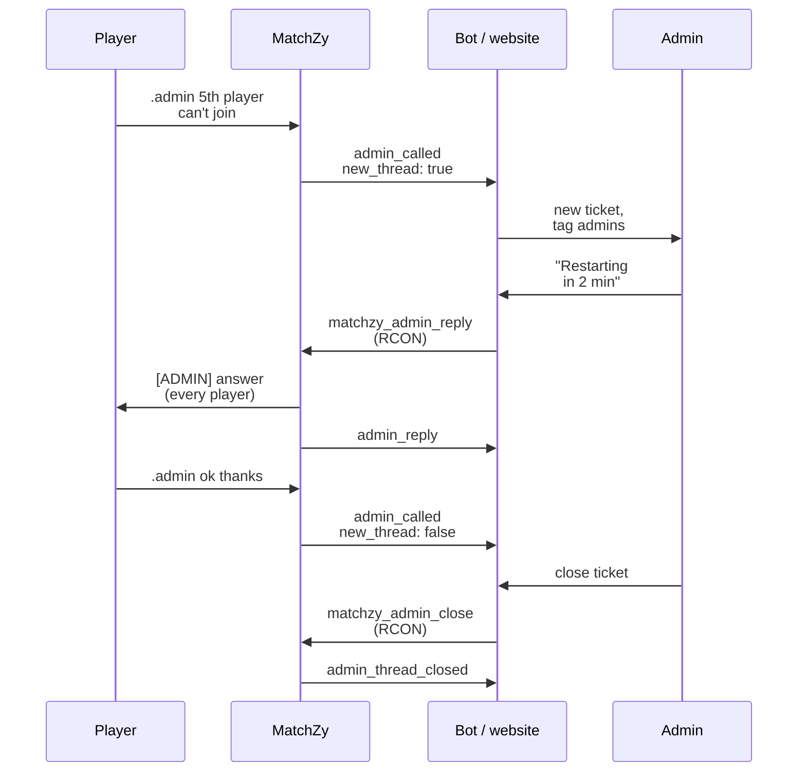

# Admin tickets (website / Discord bot)

Players can write to the admins from the game, and a website or Discord bot can answer them back on the server. MatchZy sends each message as an event to your endpoint, and your system answers over RCON.

- `.admin <message>` writes in the **match's ticket**. There is one open ticket per match, all players' messages go into it, and every player in the match sees the messages and the admins' answers. That way both teams see what was agreed ("we restore round 14").
- `.report <message>` opens a **private ticket**: only the reporter and the admins see it, and the line itself is not shown in chat. It is meant for reporting the other team.

Admins on the server also see the messages in chat. Without a website or bot, the feature still works in game.

## Turn it on

The feature is off by default, and while it is off `.admin` and `.report` do nothing (another plugin may own those commands). Turn it on and point the events to your endpoint, in `config.cfg` or a private cfg:

```text
matchzy_admin_call_enabled true
matchzy_remote_log_url "https://example.com/matchzy/events"
matchzy_remote_log_header_key "Authorization"
matchzy_remote_log_header_value "Bearer <secret>"
```

| Setting | Default | |
|---|---|---|
| `matchzy_admin_call_enabled` | `false` | Turns on `.admin`, `.calladmin` and `.report`. |
| `matchzy_admin_call_cooldown` | `5` | Seconds between two messages from the same player (spam filter). |
| `matchzy_admin_ticket_timeout` | `30` | Minutes without a message after which a ticket counts as closed. `0` = no timeout. |

A loaded match can use its own `remote_log_url` from the match config. Ticket events then go to both URLs, the server's and the match's.

## How it fits together



**`thread_id` is the ticket.** Store it next to your own ticket id (Discord channel id, database row). All messages, answers and the close event of one ticket carry the same `thread_id`.

## Events your endpoint receives

Every event is an HTTP `POST` with a JSON body. Check the header you set (`Authorization: Bearer <secret>`) before you trust it.

### `admin_called`: a player wrote

```json
{
  "event": "admin_called",
  "matchid": 1234,
  "map_number": 0,
  "map_name": "de_mirage",
  "plugin_version": "1.0.24",
  "thread_id": "8f2c0c1e5b1a4a0e9d7c2b6a1f3e4d5c",
  "kind": "admin",
  "server": { "hostname": "Liga #3", "address": "0.0.0.0:27015" },
  "call_id": "c41d9a7e2f6b4e1a8b3c5d7e9f0a1b2c",
  "new_thread": true,
  "player": { "steamid64": "76561198000000000", "name": "Mio", "team": "team1", "side": "ct" },
  "message": "our 5th player cannot join",
  "called_at": "2026-11-09T18:02:11Z"
}
```

| Field | |
|---|---|
| `new_thread` | `true` on a ticket's first message: create the ticket. `false`: add the message to the ticket with this `thread_id`. |
| `kind` | `admin` (the match's ticket, every player in the match sees it) or `report` (private). Highlight reports. |
| `call_id` | Unique per message. If a delivery is retried, store it once. |
| `player.team` | `team1` / `team2` / `spectator`, `null` without a loaded match. `side` is `ct` / `t` / `null`. |
| `matchid` | `null` without a loaded match (a scrim or pug). Use it to link to your match page. |
| `server.address` | `ip:port` as the server binds it. The ip is usually `0.0.0.0`; the port tells servers on one machine apart. |
| `message` | At most 200 characters, may be empty (a bare `.admin`). Treat it as untrusted text. |

### `admin_reply`: an admin answered

Sent after `matchzy_admin_reply`, so the answer also lands in your history (and other admins see it). It has `from`, `message` and `sent_at`, plus the common fields (`thread_id`, `kind`, `server`, `matchid`, ...).

### `admin_thread_closed`: the ticket ended

`reason` is one of:

- `admin`: closed with `matchzy_admin_close`.
- `match_end`: the match ended (series end, stop or cancel).
- `timeout`: no message for `matchzy_admin_ticket_timeout` minutes. This one is sent when the next message arrives, just before that message's `admin_called` with `new_thread: true`.

It also has `closed_at` and the common fields.

## Answering from your system (RCON)

| Command | |
|---|---|
| `matchzy_admin_reply <thread_id> <message>` | Answers a ticket. Every player in the match sees answers to the match ticket; only the reporter sees answers to a report (in chat and as center text). |
| `matchzy_admin_close <thread_id> [message]` | Closes the ticket, with an optional last message. The next `.admin` opens a new ticket. |
| `matchzy_test_event` | Sends a `test_event` to your endpoint so you can check the connection. |

Instead of the `thread_id` you can also give a `call_id`, or a player's SteamID64 (their open report, otherwise the match's ticket).

!!! warning "Clean the text before you send it over RCON"
    An RCON line is a console command. A `;` or a line break in the message ends the command and starts a new one, so an admin's text (or text copied from a player) could run any server command. Remove `;`, `"` and line breaks from the message, and limit it to 200 characters, before you send it.

=== "Node.js (rcon-srcds)"

    ```js
    import Rcon from "rcon-srcds";

    async function reply(server, threadId, text) {
      const clean = text.replace(/[;"\r\n]/g, " ").slice(0, 200);
      const rcon = new Rcon({ host: server.host, port: server.port });
      await rcon.authenticate(server.rconPassword);
      await rcon.execute(`matchzy_admin_reply ${threadId} ${clean}`);
      rcon.disconnect();
    }
    ```

=== "Python (rcon)"

    ```python
    import re
    from rcon.source import Client

    def reply(server, thread_id, text):
        clean = re.sub(r'[;"\r\n]', " ", text)[:200]
        with Client(server["host"], server["port"], passwd=server["rcon_password"]) as rcon:
            rcon.run(f"matchzy_admin_reply {thread_id} {clean}")
    ```

The server address in the event is the bind address, usually `0.0.0.0`. Your system already knows which public address it gave the match; look the server up by `matchid` or by the port.

## Recipe: Discord bot

1. **Endpoint**: a small web server in the bot receives the events and checks the secret header.
2. **`admin_called` with `new_thread: true`**: create a channel (or a thread) in your ticket category. Post an embed with the match (link built from `matchid`), the server (`server.hostname`, port), the map, the player (name, SteamID64, team) and the message. Mention your admin role. For `kind: "report"`, use a red embed with "REPORT" in the title, and keep the channel hidden from players.
3. Store `thread_id` → channel id.
4. **`admin_called` with `new_thread: false`**: post the message in the stored channel.
5. **An admin writes in the channel**: send it with `matchzy_admin_reply <thread_id> <text>` (cleaned, see above). Ignore your own bot's messages, and the `admin_reply` event that comes back, or post it as a quiet log line.
6. **A close button or command** in the channel: send `matchzy_admin_close <thread_id>`. On `admin_thread_closed`, archive or close the channel.

A Discord webhook can only post messages. Creating channels and reading admins' answers needs a bot (bot token). Ticket bots such as Ticket Tool keep working for your other tickets; the MatchZy bot runs next to them.

## Recipe: match page on a website

- **Ticket panel**: one row per `thread_id` with its messages (`admin_called`, `admin_reply`) in time order, and a text box that sends `matchzy_admin_reply` through your backend. Never send RCON from the browser.
- **Match chat with history**: while a match is loaded, MatchZy also sends every chat line as `player_say` (see [Events](../reference/events.md)). Store them by `matchid` and show them on the match page. To write to everyone on the server, send `css_asay <message>` over RCON (cleaned the same way).

## Good to know

- One open match ticket per match (per server without a loaded match). A player's `.report` is their own ticket.
- Messages and answers in game: the match ticket is shown to every player on the server, a report only to the reporter and the admins (players with `@css/generic` or in MatchZy's `admins.json`).
- The ticket ends with the match. After a series ends, `.admin` on the same server opens a new ticket (`matchid` of the next match, or `null`).
- If your endpoint is down, MatchZy logs the failed send (`[SendEventAsync]`) and the players still see their messages in game; there is no resend later.
