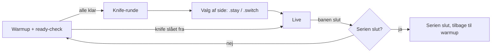

# Spiltyper

MatchZy kører serveren i én mode ad gangen. Admins skifter med en kommando i chatten; valget huskes på tværs af baneskift.

| Mode | Kommando | Knife | Runder | Penge | Brug den til |
|---|---|---|---|---|---|
| **Match** | `.match` | Ja | MR12 med overtid, kan afgøres tidligt | 800 | Konkurrencekampe og pugs. |
| **Scrim** | `.scrim` | Nej | Alle 24 runder spilles, ingen overtid | 800 | Scrims, hvor begge halvlege skal spilles færdige. |
| **Hill** | `.hill` | Nej | Alle 24 runder spilles | 16000 | Full-buy-runder, fx retakes eller aim-træning med hold. |
| **Practice** | `.prac` | - | Uendelige | Ubegrænsede, køb overalt | Lære lineups, spawns og udførelser. |
| **Dryrun** | `.dry` | Nej | Normale runder med 6 sekunders freeze time, til den stoppes | 16000 | Øve udførelser mod bots eller dit hold. |
| **Sleep** | `.sleep` | - | - | - | Hvilende server uden noget loadet. |

Hver mode kører sin egen cfg fra `cfg/MatchZy/` (`live.cfg`, `scrim.cfg`, `hill.cfg`, `prac.cfg`, `dryrun.cfg`, `sleep.cfg`, plus `warmup.cfg` og `knife.cfg`). Ret i de filer, eller bedre i en `<mode>_override.cfg`, for at ændre reglerne. Se [Filer og mapper](../reference/files.md#server-specific-settings).

## Holdstørrelser { #team-sizes }

En kamp spilles som competitive (5v5), medmindre dens match config sætter `game_mode`. MatchZy skifter serverens `game_mode`, før banen loader, og bruger den spiltypes live-cfg:

| `game_mode` | Hold | Server-mode | Live-cfg |
|---|---|---|---|
| `competitive` | 5v5 | `game_type 0`, `game_mode 1` | `live.cfg` |
| `wingman` | 2v2 | `game_type 0`, `game_mode 2` | `live_wingman.cfg` |
| `rush` | 3v3 | `game_type 0`, `game_mode 6` | `live_rush.cfg` (Valves rush-regler: 15 runder, ingen halvleg, 40 sekunders runder) |
| `1v1` | 1v1 | `game_type 0`, `game_mode 2` | `live_1v1.cfg` (wingman-format: MR8, 16 runder, maks. $8000, 1:30 runder) |

`players_per_team` følger spiltypen, medmindre match configen sætter den. En mapliste med kun rush-baner (`rush_001` og andre `rush_`-baner, `aim_rush`) spilles som rush uden `game_mode`. Uden en match config følger live-cfg'en serverens egen `game_mode` (`2` wingman, `6` rush), og en rush-bane får også `live_rush.cfg`. Admins skifter serverens spiltype med `.1v1`, `.wingman` eller `.5v5` (eventuelt med en bane); banen genindlæses, fordi `game_mode` kun skifter ved en map load. En `.1v1`-pug kører i wingman-spiltypen med `live_1v1.cfg`. I en pug følger antallet af klar-spillere spiltypen: højst 2 for 1v1, 4 for wingman og 6 for rush, så `.readyrequired` er ikke nødvendig (en lavere `matchzy_minimum_ready_required` gælder stadig). `.matchsetup` spørger efter spiltypen, se [Menuer](menus.md#matchsetup-wizard).

## Mode ved opstart { #mode-on-startup }

`matchzy_autostart_mode` bestemmer, hvad en ny bane starter i:

| Værdi | Resultat |
|---|---|
| `0` | Sleep, intet loadet. |
| `1` | Match-warmup (standard). |
| `2` | Practice. |

Mode-kommandoerne (`.prac`, `.match`, `.scrim`, `.sleep`, `.exitprac`) sætter også denne værdi, så en practice-server bliver i practice efter `.map`.

## Kampens forløb { #match-flow }

Med en match config kører vetoet før warmup. Scrim og hill springer knife-runden over.

Vil du have en warmup med respawn med det samme ved holdets spawn, 2 sekunders spawn protection, ingen bombe, ingen friendly fire, køb hele warmup og fulde penge ved hver respawn, så sæt `matchzy_warmup_instant_respawn true`. Den sættes efter `warmup.cfg`, så du behøver ikke rette i din cfg. Spillere, der joiner et hold under warmup, spawner også med det samme.
