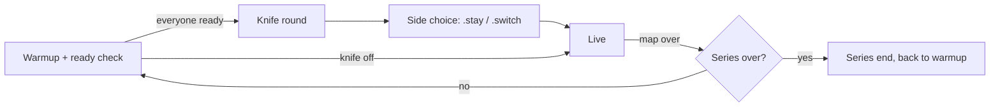

# Game modes

MatchZy runs the server in one mode at a time. Admins switch with a chat command; the choice is remembered across map changes.

| Mode | Command | Knife | Rounds | Money | Use it for |
|---|---|---|---|---|---|
| **Match** | `.match` | Yes | MR12 with overtime, can clinch | 800 | Competitive matches and pugs. |
| **Scrim** | `.scrim` | No | All 24 rounds played, no overtime | 800 | Scrims where both halves should be played out. |
| **Hill** | `.hill` | No | All 24 rounds played | 16000 | Full-buy rounds, e.g. retakes-style or aim sessions with teams. |
| **Practice** | `.prac` | - | Endless | Unlimited, buy anywhere | Learning lineups, spawns, executes. |
| **Dryrun** | `.dry` | No | Normal rounds with a 6 second freeze time, until stopped | 16000 | Running executes against bots or your team. |
| **Sleep** | `.sleep` | - | - | - | Idle server with nothing loaded. |

Every mode executes its own cfg from `cfg/MatchZy/` (`live.cfg`, `scrim.cfg`, `hill.cfg`, `prac.cfg`, `dryrun.cfg`, `sleep.cfg`, plus `warmup.cfg` and `knife.cfg`). Edit those files, or better a `<mode>_override.cfg`, to change the rules. See [Files and folders](../reference/files.md#server-specific-settings).

## Team sizes

A match plays as competitive (5v5) unless its match config sets `game_mode`. MatchZy switches the server's `game_mode` before the map loads and uses that mode's live cfg:

| `game_mode` | Teams | Server mode | Live cfg |
|---|---|---|---|
| `competitive` | 5v5 | `game_type 0`, `game_mode 1` | `live.cfg` |
| `wingman` | 2v2 | `game_type 0`, `game_mode 2` | `live_wingman.cfg` |
| `rush` | 3v3 | `game_type 0`, `game_mode 6` | `live_rush.cfg` (Valve's rush rules: 15 rounds, no halftime, 40 second rounds) |
| `1v1` | 1v1 | `game_type 0`, `game_mode 2` | `live_1v1.cfg` (wingman format: MR8, 16 rounds, $8000 max money, 1:30 rounds) |

`players_per_team` follows the mode unless the match config sets it. A maplist with only rush maps (`rush_001` and other `rush_` maps, `aim_rush`) plays as rush without `game_mode`. Without a match config, the live cfg follows the server's own `game_mode` (`2` wingman, `6` rush), and a rush map also gets `live_rush.cfg`. Admins switch the server's mode with `.1v1`, `.wingman` or `.5v5` (optionally with a map); the map reloads, since `game_mode` only changes on a map load. A `.1v1` pug runs in the wingman game mode with `live_1v1.cfg`. In a pug the ready count follows the mode: at most 2 ready players for 1v1, 4 for wingman and 6 for rush, so `.readyrequired` is not needed (a lower `matchzy_minimum_ready_required` still applies). `.matchsetup` asks for the mode, see [Menus](menus.md#matchsetup-wizard).

## Mode on startup

`matchzy_autostart_mode` decides what a fresh map starts in:

| Value | Result |
|---|---|
| `0` | Sleep, nothing loaded. |
| `1` | Match warmup (default). |
| `2` | Practice. |

The mode commands (`.prac`, `.match`, `.scrim`, `.sleep`, `.exitprac`) also set this value, so a practice server stays in practice after `.map`.

## Match flow

With a match config the veto runs before warmup. Scrim and hill skip the knife round.

For a warmup with instant respawn at the team spawn, 2 seconds of spawn protection, no bomb, no friendly fire, buying all warmup and full money on every respawn, set `matchzy_warmup_instant_respawn true`. It is applied after `warmup.cfg`, so you do not have to edit your cfg.
